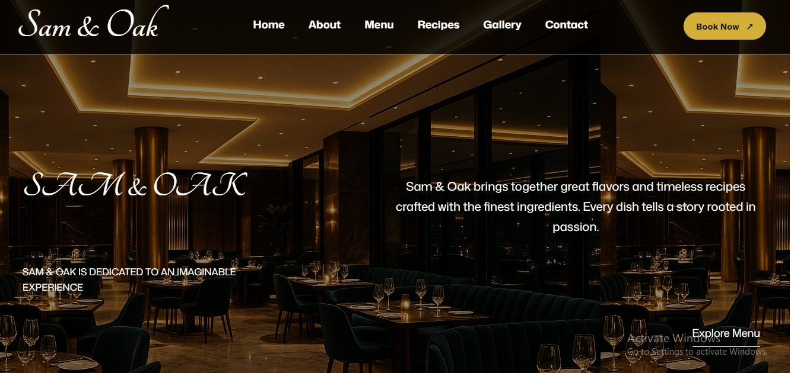

# Sam & Oak Restaurant 🍽️

A luxurious and modern restaurant website designed to deliver an elegant digital dining experience. Sam & Oak combines sophisticated design, beautiful food presentation, and a responsive interface to showcase a premium restaurant brand.

## 🌐 Live Demo

[Visit Sam & Oak Restaurant](https://sam-oak.vercel.app/)

## 📖 About the Project

Sam & Oak Restaurant is a frontend web development project created to demonstrate my ability to build modern, visually appealing, and responsive websites using vanilla HTML, CSS, and JavaScript.

The website reflects the atmosphere of a luxury restaurant, featuring elegant layouts, refined typography, beautiful imagery, and a premium visual identity.

## ✨ Features

- Elegant and luxurious restaurant design
- Fully responsive layout
- Modern homepage and hero section
- Beautiful food and dining presentation
- Smooth navigation
- Interactive UI elements
- Clean and organized layout
- Mobile-friendly experience

## 🛠️ Technologies Used

- HTML5
- CSS3
- JavaScript
- Vercel (Deployment)

## 📸 Preview

<!-- Add your website screenshots here -->



## 🚀 Getting Started

To run this project locally:

1. Clone the repository:

   ```bash
   git clone YOUR_REPOSITORY_URL
   ```

2. Navigate into the project folder:

   ```bash
   cd sam-oak
   ```

3. Open `index.html` in your browser.

## 🎯 Project Goals

- Improve my frontend development skills.
- Practice responsive web design.
- Build visually appealing user interfaces.
- Develop practical experience with HTML, CSS, and JavaScript.
- Create projects for my frontend developer portfolio.

## 👨‍💻 Author

**Olumide Samuel Abifade**

Frontend Developer | HTML | CSS | JavaScript

- Portfolio: [My Portfolio](olumide-abifade-portfolio.vercel.app
)
- GitHub: [My GitHub](YOUR_GITHUB_URL)

## ⭐ Support

If you like this project, feel free to give it a star!

---

*Designed and developed with passion for beautiful web experiences.*
